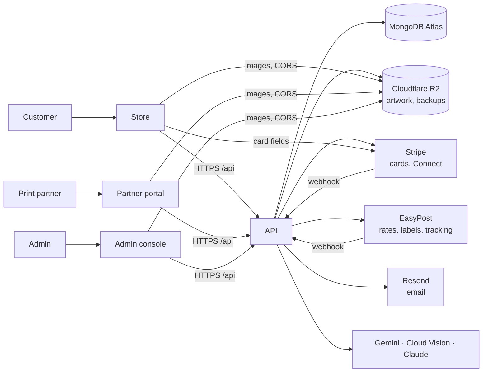

# Architecture

## The pieces

| App | Folder | Stack | Hosting |
| --- | --- | --- | --- |
| API | `space-transfer-server` | Node 26, Express 4, TypeScript, Mongoose 8, sharp | Render web service (Docker), one instance |
| Store | `space-transfers` | React 18, Vite, Tailwind 4, Stripe Elements | Render static site |
| Admin console | `space-transfers-admin` | React 19, Vite, Tailwind 4, Recharts | Render static site |
| Partner portal | `space-transfer-printer` | React 19, Vite, Tailwind 4 | Render static site |

The front ends are single-page apps with no server of their own. Each is built with its API address (`VITE_API_URL`) compiled in, so changing that address takes a new build.

## The API

Every route is under `/api`. One router file per audience:

| Prefix | Who | File |
| --- | --- | --- |
| `/auth` | Everyone: sign-in, sign-up, reset, passkeys, Google | `routes/auth.routes.ts` |
| `/customer` | Signed-in customers (some endpoints allow guests) | `routes/customer.routes.ts` |
| `/printer` | Partners | `routes/printer.routes.ts` |
| `/admin` | Admins with a passkey | `routes/admin.routes.ts` |
| `/payouts` | Partners' Stripe Connect and admins' payout actions, plus Stripe's webhook | `routes/payout.routes.ts` |
| `/webhooks` | EasyPost's tracking webhook | `routes/webhook.routes.ts` |
| `/public` | Anyone: the legal documents and the store's public figures | `routes/public.routes.ts` |
| `/geocode`, `/health` | Address lookup; the health check Render polls | |

A request passes through route, then middleware (`middleware/auth.ts`, `rateLimit.ts`, `upload.ts`), then a controller (`controllers/<audience>/`). Controllers stay thin; the rules are in `services/`. Errors go through `middleware/error.ts`, which turns known errors into clean JSON and reports the rest to Sentry.

`server.ts` connects to the database, starts the HTTP server and starts the background jobs. The jobs are listed under "Background jobs" in the API README. They are plain timers inside the process, which is the main reason there must be exactly one instance.

### Live updates

Order pages and notification bells update live through Server-Sent Events. `services/orderSyncHub.ts`, `adminNotificationsHub.ts` and `printerNotificationsHub.ts` keep the open connections in memory and push to them when something changes. A restart drops the connections, and the browsers reconnect.

## Data

MongoDB, one database. The collections, by model in `src/models/`:

| Model | Holds |
| --- | --- |
| `user` | Every account: customers, partners and admins (`role`). Also sub-accounts (`parentAccount`), the partner's business profile, availability and Stripe account, passkeys, the token version, the saved cart and the legal acceptance |
| `design` | A saved sheet: its items, placements and sheet settings |
| `asset` | An uploaded image: its stored URLs, size, DPI and transparency verdict |
| `order` | An order: items (snapshots of the sheets), addresses, pricing, payment and refunds, shipping and label, status history, the assigned partner, reprint and cancellation links, the rights record |
| `orderIssue` | A problem report, with its two conversations (customer and partner) and its outcome |
| `payout` | A partner payout: its jobs, its status, and the Stripe transfer and payout ids |
| `settings` | Admin-editable settings: pricing, sheet size, shipping, tax, partner pay, assignment and SLA (`global_pricing` and related documents) |
| `legalDocument` | The three legal documents, with every published version and the current draft |
| `rightsScreen`, `rightsDispute`, `rightsRule` | The rights check: each image's cached verdict, customers' disputes, and admins' blocked images and watch terms |
| `gangsheetExport`, `gangsheetExportAudit` | Print-file exports and who downloaded them |
| `adminNotification`, `adminNotificationEmailBatch`, `printerNotification` | In-app notifications and the queue of admin emails |
| `loginActivity` | Sign-in history shown in account security |

An order copies what it needs at the moment it is placed: the sheet contents, prices and addresses. Later edits to a design or to the settings never change an existing order.

### Files

- **Artwork and other uploads** go to a public R2 bucket through `services/storage.service.ts`. Addresses are built from `R2_PUBLIC_BASE_URL`, and that address is stored in the database. Problem-report photos are under `issues/<userId>/`.
- **The browser reads artwork pixels** for cropping, DPI and transparency checks, so the bucket must allow GET and HEAD from the three front ends' origins (CORS).
- **The server fetches stored files only through `fetchStoredArtwork`.** It refuses any address that isn't one of our own stored files and does not follow redirects. Use it for any URL a caller can influence.
- **Print exports and order previews** are drawn by `services/gangsheetExport.service.ts` and `orderPreview.service.ts`. They are written to `uploads/` on the API's disk and removed after 14 days; they are made again on request.
- **Backups** are encrypted and written to `backups/<date>/` in `BACKUP_R2_BUCKET`.

## Accounts and sign-in

- **Roles.** `CUSTOMER`, `PRINTER` (partner) and `ADMIN`, in one collection. An email is unique per role, so one person can be a customer and a partner with the same address. Each front end accepts only its own role and signs out any other.
- **Sessions** are JWTs sent in the `Authorization` header. Each carries the account's `tokenVersion`; raising it ends every earlier session. A password change, a password reset or a passkey reset does that. Suspended accounts are refused on their next request.
- **Passkeys** (WebAuthn, `@simplewebauthn/server`) are the second step of sign-in when an account has one. They are required for admins. They are bound to the hostname the console is served from.
- **Sub-accounts** belong to a customer's main account, up to four per account.
- **Admins** are created only with `scripts/create-admin.mjs`. Registration refuses the admin role.

## How an order moves

1. **Build.** The customer uploads artwork. The store converts it, trims it and checks it. The API stores it, screens its rights and creates an `asset`. Signed-in customers' sheets autosave as `design`s.
2. **Cart.** The cart holds one line per sheet, frozen as it was when added (see [DECISIONS.md](DECISIONS.md)). It is saved on the user so it follows them between devices.
3. **Quote.** At checkout the API prices the sheets, gets live rates from EasyPost from the partner most likely to ship the order, and the carrier checks the address.
4. **Pay.** The API creates a Stripe PaymentIntent for the amount it computed. The store collects the card with Stripe Elements; the card number never reaches our server.
5. **Order.** The store sends the order. The API checks the payment with Stripe (succeeded, this customer, the exact amount) and checks rights again. Then it saves the order and sends the confirmation.
6. **Assign.** Automatic assignment picks an active, open partner under their job limit: in the customer's state first, then the nearest in their region, then the next region (`services/orderAssignment.service.ts`).
7. **Fulfil.** The partner accepts and prints, using the 300 DPI export. Marking the job ready to ship buys the label in the background.
8. **Deliver.** EasyPost's webhook, backed up by a poller, moves the order to Shipped and then Completed. Completed makes the job payable.
9. **Pay the partner.** On Fridays the API drafts payouts. An admin approves and pays each one: a Stripe transfer to the partner's connected account, then a payout to their bank.

The status names each audience sees are in the API README under "How an order moves". The three front ends use different words for the same stored status. When you change one, change all three, so the store, the admin console and the partner portal never disagree.

## External services

| Service | Used for | Without it |
| --- | --- | --- |
| MongoDB Atlas | Everything | The API won't start |
| Cloudflare R2 | Artwork, uploads, backups | Every upload fails with a clear 503 |
| Stripe | Card payments; partner payouts through Connect (Express accounts) | Checkout says payment is unavailable; payouts can't be made |
| EasyPost | Rates, address checks, labels, tracking | Flat shipping rates; no labels; no tracking |
| Resend | All email | Email is skipped and logged |
| Google Gemini | AI image edits | AI image edits are hidden; board commands and the in-browser tools still work |
| Google Cloud Vision | Rights check: logos, web matches, text | That layer is skipped |
| Anthropic (Claude) | Rights check: characters, brands, watermarks | That layer is skipped |
| Google OAuth | Sign in with Google (store); Save to Drive (partner portal) | Those buttons are hidden |
| Sentry | Error reports from all four apps | Errors are only logged |

The API never turns a third-party failure into one of its own auth errors. If an upstream service answers 401 and we pass it on, the front end reads it as our session expiring and signs the user out. Unconfigured services answer 503 with what is missing.
